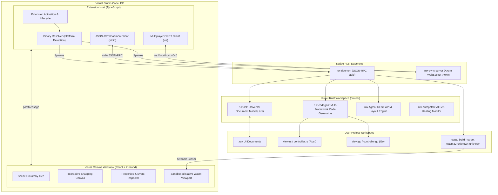
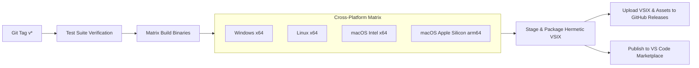

# ⚡ Ruxel Studio

<div align="center">

**The Cross-Platform Visual UI Editor for Rust & Go Desktop Frameworks**

[](https://marketplace.visualstudio.com/items?itemName=c0mbit.ruxel-studio)[](https://github.com/c0mbit/ruxel-studio/actions/workflows/release-publish.yml)
[](LICENSE.md)
[](https://www.rust-lang.org/)
[](https://go.dev/)
[](https://www.typescriptlang.org/)

[Overview](#overview) • [Key Features](#key-features) • [Supported Frameworks](#supported-frameworks) • [Architecture](#architecture) • [Getting Started](#getting-started) • [Autonomous Maintenance](#autonomous-maintenance--cicd) • [License](#license)

</div>

---

## Overview

Modern systems programming languages like **Rust** and **Go** have experienced a renaissance in native desktop GUI toolkits—ranging from Elm-inspired architectures ([Iced](https://github.com/iced-rs/iced)) and immediate-mode renderers ([egui](https://github.com/emilk/egui)) to reactive toolkits ([Slint](https://slint.dev/), [Dioxus](https://dioxuslabs.com/)) and retain-mode graphics engines ([Fyne](https://fyne.io/)).

However, developing native desktop UIs in Rust and Go has traditionally suffered from a critical bottleneck: **the lack of visual design tooling**. Developers are forced to hand-code thousands of lines of coordinate mathematics, layout wrappers, and styling structs, enduring slow recompilation cycles just to nudge a button by 4 pixels.

**Ruxel Studio** bridges this gap. Built directly as a native Visual Studio Code extension powered by high-performance Rust daemons, Ruxel Studio delivers **JavaFX Scene Builder** and **Qt Designer** visual ergonomics to the Rust and Go ecosystems.

### Core Mission
- **Zero Runtime Overhead**: Generates idiomatic, pure native code without external runtime dependencies or proprietary lock-in.
- **Lossless Two-Way Sync**: Edit visually in the drag-and-drop designer or edit code in your editor—neither overwrites the other.
- **Zero-Mockup Real Wasm Preview**: Compiles the actual framework codebase directly to WebAssembly in background sandbox threads for true pixel-perfect fidelity.
- **100% Free & Open-Source**: All 12 development levels are dual-licensed under MIT and Apache-2.0 with zero paywalls, zero telemetry gating, and full enterprise capabilities out of the box.

---

## Key Features

```
┌─────────────────────────────────────────────────────────────────────────────────┐
│                                 RUXEL STUDIO                                    │
│  ┌───────────────────────┐  ┌───────────────────────┐  ┌──────────────────────┐ │
│  │   Visual UI Builder   │  │  Round-Trip Sync Engine│  │  Native Wasm Sandbox │ │
│  │  • Scene Builder tree │  │  • syn / quote AST    │  │  • Background cargo   │ │
│  │  • Snapping & margins │  │  • Controller preserve│  │  • Hot Wasm reload    │ │
│  │  • Flexbox & Grid     │  │  • Reverse AST parser │  │  • Zero HTML mockups  │ │
│  └───────────────────────┘  └───────────────────────┘  └──────────────────────┘ │
│  ┌───────────────────────┐  ┌───────────────────────┐  ┌──────────────────────┐ │
│  │  Figma-to-Code Engine │  │  CRDT Multiplayer Hub │  │ AI Self-Healing Sync │ │
│  │  • Auto-layout import │  │  • Axum WebSocket svc │  │  • Upstream tracking │ │
│  │  • Heuristic detector │  │  • Conflict-free edit │  │  • Sandbox patch loop │ │
│  │  • Design tokens      │  │  • Cloud UI presets   │  │  • Auto-PR generation │ │
│  └───────────────────────┘  └───────────────────────┘  └──────────────────────┘ │
└─────────────────────────────────────────────────────────────────────────────────┘
```

### 🎨 Visual UI Editor & Inspector
- **Scene Builder Parity**: Full-featured visual canvas with hierarchical component tree, drag-and-drop parenting, depth reordering, and multi-element grouping.
- **Intelligent Layout Engine**: Visual controls for Flexbox (`Row`, `Column`, `Stack`), CSS-like Grid, absolute layouts, dynamic padding, margins, alignment, and distribution.
- **Smart Alignment & Snapping**: Real-time magnetic snap guides, edge-to-edge alignment lines, and equal-spacing distribution indicators.
- **Comprehensive Inspector**: Multi-tab inspector exposing Geometry, Layout Constraints, Typography, Color Palettes, Border Radii, Box Shadows, and Event Handlers.

### 🔄 Bidirectional Round-Trip Synchronization
- **Strict View-Controller Separation**: Ruxel Studio cleanly decouples declarative UI definitions (`view.rs`) from interactive business logic (`controller.rs`).
- **AST Preservation via `syn` & `quote`**: The code generation engine parses existing controller files and seamlessly merges new event handlers and state fields without overwriting user logic.
- **Reverse Parser Engine**: Manually change a property in code (e.g., `width: 320.0` or `label: "Submit"`), and the `rux-daemon` reverse AST parser immediately updates the visual canvas in real time.

### ⚡ Zero-Mockup Native Wasm Preview
- **True Engine Execution**: Unlike web-based layout approximations, Ruxel Studio spins up background compiler tasks targeting `wasm32-unknown-unknown`.
- **Sandboxed Interactive Preview**: The compiled WebAssembly bundle runs inside an isolated canvas sandbox in the Webview editor, letting you test button clicks, hover states, scroll containers, and theme switches against the actual native graphics pipeline.

### 📐 Figma-to-Code Engine
- **Direct REST API Integration**: Ingest Figma frames, components, and design systems using personal access tokens.
- **Auto-Layout to Flexbox Mapping**: Intelligently converts Figma Auto Layout frames into optimal native container hierarchies.
- **Heuristic Component Detection**: Automatically identifies buttons, text inputs, avatars, toggles, badges, and modal dialogs from raw vector layers and naming patterns.
- **Design Token Extraction**: Exports typography styles, color palettes, and spacing variables directly into reusable Rust and Go theme structs.

### 👥 Real-Time CRDT Multiplayer Collaboration
- **Conflict-Free Concurrent Editing**: Powered by `rux-sync-server`, multiple developers and designers can collaborate on the same `.rux` document simultaneously without merge conflicts.
- **Live Presence & Cursors**: Visualizes team members' active selections, bounding boxes, and cursor positions in real time over WebSockets.
- **Cloud Presets Storage**: Share reusable component templates and composite widgets across your team with SQLite or in-memory backing.

### 🤖 AI-Driven Self-Healing Framework Sync
- **Autonomous Upstream Tracking**: The `rux-autopatch` daemon monitors crates.io, GitHub releases, and upstream git repositories for breaking API changes across Iced, Slint, egui, and Fyne.
- **LLM-Powered AST Patching**: Analyzes syntax discrepancies, synthesizes template patches, and executes automated compiler test loops in a sandboxed verification environment.
- **Zero-Touch Maintenance**: Generates verified pull requests automatically when upstream libraries release breaking revisions.

### 🌐 Enterprise Tooling
- **Smart Asset Manager**: Drag-and-drop asset management supporting SVGs, raster images, and automated binary memory embedding (`include_bytes!`).
- **i18n Localization**: Native Mozilla Project Fluent (`.ftl`) generation with typed translation key resolution and live in-editor language switching.
- **Multi-Screen Declarative Router**: Visual state machine and screen navigation editor generating compile-time checked routing graphs.
- **Comprehensive Theme Engine**: Built-in Light, Dark, High-Contrast, and custom brand themes with runtime token substitution.

---

## Supported Frameworks

Ruxel Studio supports an extensible code generator plugin architecture:

| Framework | Language | Paradigm | Rendering Backend | Generator Plugin | Status |
|:---|:---|:---|:---|:---|:---:|
| **[Iced](https://github.com/iced-rs/iced)** | Rust | Elm Architecture (Model-Update-View) | `wgpu` / Software | `IcedPlugin` | ✅ Production |
| **[egui](https://github.com/emilk/egui)** | Rust | Immediate Mode | `wgpu` / `glow` | `EguiPlugin` | ✅ Production |
| **[Slint](https://slint.dev/)** | Rust | Declarative & Reactive | Skia / FemtoVG / Software | `SlintPlugin` | ✅ Production |
| **[Dioxus](https://dioxuslabs.com/)** | Rust | Declarative Virtual DOM | Tao / Wry / Skia | `DioxusPlugin` | ✅ Production |
| **[Fyne](https://fyne.io/)** | Go | Retained Mode & Material | OpenGL / Software | `FynePlugin` | ✅ Production |
| **[Flet](https://flet.dev/)** | Python | Reactive | Flutter Engine | `FletPlugin` | ✅ Production |

---

## Architecture

Ruxel Studio is organized as an enterprise-grade monorepo combining a high-performance native Rust core with a modern TypeScript/React VS Code extension host.



### Monorepo Structure

```
ruxel-studio/
├── .github/
│   └── workflows/
│       ├── release-publish.yml     # Zero-touch cross-platform CI/CD & GitHub Releases distribution
│       └── framework-sync.yml      # AI framework self-healing sync pipeline
├── crates/
│   ├── rux-ast/                    # Universal UI document model, schema validator, .rux serializer
│   ├── rux-codegen/                # Multi-framework generators, syn controller merger, reverse parser
│   ├── rux-figma/                  # Figma API parser, auto-layout mapper, heuristic element classifier
│   ├── rux-daemon/                 # Local JSON-RPC daemon, file watcher (notify), wasm compiler
│   ├── rux-sync-server/            # Axum/Tokio WebSocket collaboration server & CRDT hub
│   └── rux-autopatch/              # Autonomous upstream framework monitor & sandbox verifier
├── packages/
│   ├── extension/                  # VS Code Extension Host (TypeScript, binary resolution, RPC)
│   ├── webview/                    # Visual Editor UI (React 18, Zustand, Canvas, Inspector)
│   └── shared-types/               # Protocol definitions & cross-language schema bindings
├── scripts/
│   └── stage-release.mjs           # Hermetic packaging, binary staging, and verification pipeline
├── Cargo.toml                      # Workspace Cargo definition
├── package.json                    # Workspace npm definition
└── LICENSE.md                      # Dual MIT / Apache-2.0 license declaration
```

---

## Getting Started

### Installation

#### 1. Primary Method: Visual Studio Code Marketplace (Recommended)

The easiest and official way to install Ruxel Studio is directly from inside Visual Studio Code:

1. Launch Visual Studio Code.
2. Open the **Extensions** view (`Ctrl+Shift+X` on Windows/Linux or `Cmd+Shift+X` on macOS).
3. Search for **`Ruxel Studio`** or **`c0mbit`**.
4. Click **Install**.
5. *Command-line shortcut*:
   ```bash
   code --install-extension c0mbit.ruxel-studio
   ```

You can also install directly from the [Visual Studio Marketplace](https://marketplace.visualstudio.com/items?itemName=c0mbit.ruxel-studio).

#### 2. Secondary Fallback: Manual VSIX Installation (GitHub Releases)

For offline environments or custom distribution, precompiled packages are available on GitHub Releases:

1. Navigate to [GitHub Releases](https://github.com/c0mbit/ruxel-studio/releases).
2. Under the release assets, download the compiled `ruxel-studio-*.vsix` package.
3. In VS Code, open the **Extensions** view (`Ctrl+Shift+X` / `Cmd+Shift+X`).
4. Click the **Views and More Actions** menu (`...` in the top right corner of the Extensions panel).
5. Select **Install from VSIX...** and choose the downloaded file.
6. *Command-line alternative*:
   ```bash
   code --install-extension ruxel-studio-*.vsix
   ```

### Building from Source (Local Development)

#### Prerequisites
- **Node.js**: `v18.0.0` or higher
- **Rust Toolchain**: `1.75.0` or higher (`stable`)
- **Cargo**: Standard cargo installation (`rustup default stable`)
- **WebAssembly Target**: `rustup target add wasm32-unknown-unknown` (for interactive preview)
- *(Optional)* **Go**: `1.21` or higher (for Fyne code generation testing)

#### Local Setup & Verification

1. **Clone the repository**:
   ```bash
   git clone https://github.com/c0mbit/ruxel-studio.git
   cd ruxel-studio
   ```

2. **Install Node.js dependencies**:
   ```bash
   npm install
   ```

3. **Build the Rust Daemons & Crates**:
   ```bash
   cargo build --release
   ```

4. **Build the TypeScript Extension & Webview packages**:
   ```bash
   npm run build
   ```

5. **Run the Workspace Verification Suite**:
   ```bash
   cargo test --workspace
   npm run test
   ```

---

## Running Ruxel Studio in VS Code

### Debugging & Development
1. Open the project root in Visual Studio Code:
   ```bash
   code .
   ```
2. Press **`F5`** (or go to **Run and Debug** -> select **`Extension + Webview`**).
3. A new **Extension Development Host** window will launch with Ruxel Studio active.

### Creating Your First Visual UI
1. In the Extension Host workspace, create a new file named `main_window.rux`.
2. Right-click the file and select **Open with Ruxel Studio** (or open it directly).
3. Drag components from the **Palette** (Buttons, Containers, Inputs) onto the **Canvas**.
4. Configure layout constraints, alignments, and styling in the **Inspector** on the right.
5. Open the Command Palette (`Ctrl+Shift+P` / `Cmd+Shift+P`) and execute:
   ```
   Ruxel: Generate & Export Code
   ```
6. Select your target framework (e.g. **Iced** or **Slint**). Ruxel Studio will generate:
   - `src/ui/main_window_view.rs` (Generated declarative layout)
   - `src/ui/main_window_controller.rs` (Event handlers & state controllers)

---

## Figma-to-Code Workflow

Transform vector designs into production-ready Rust or Go source code in seconds:

1. Obtain a **Figma Personal Access Token** and your **File Key** (`figma.com/file/<FILE_KEY>/...`).
2. Open the Command Palette in VS Code:
   ```
   Ruxel: Import from Figma
   ```
3. Enter your token and file key.
4. Select the target frame or component.
5. The `rux-figma` engine automatically:
   - Resolves auto-layout directions, gaps, and paddings into native flexbox containers.
   - Detects UI patterns (e.g., classifying a rounded rectangle with centered text as a `Button`).
   - Generates a clean `.rux` AST document and immediately reflects it on your visual canvas.

---

## Real-Time Collaboration (Multiplayer)

To collaborate with teammates in real time:

1. **Start the Collaboration Server** (or use an internal team deployment):
   ```bash
   cargo run --release --bin rux-sync-server
   ```
   *Default port: `4040` (configurable via `PORT=XXXX`).*

2. **Connect in VS Code**:
   - In VS Code Settings, configure:
     ```json
     {
       "ruxel.collaboration.serverUrl": "ws://your-team-server:4040",
       "ruxel.collaboration.room": "design-system-room"
     }
     ```
   - Open any `.rux` document. You will see team presence markers, active selections, and concurrent edit synchronizations in real time.

---

## Autonomous Maintenance & CI/CD

Ruxel Studio features an autonomous continuous integration and release engineering pipeline defined in `.github/workflows/`:



### Hermetic Cross-Platform Packaging
The custom staging pipeline (`scripts/stage-release.mjs`) bundles precompiled native binaries for:
- `win32-x64` (`rux-daemon.exe`, `rux-sync-server.exe`)
- `linux-x64` (`rux-daemon`, `rux-sync-server`)
- `darwin-x64` (`rux-daemon`, `rux-sync-server`)
- `darwin-arm64` (`rux-daemon`, `rux-sync-server`)

The extension's `BinaryResolver` detects the host platform at runtime, verifies execute permissions, and spawns the bundled daemons with zero configuration required from the user.

---

## Configuration Settings

Customize Ruxel Studio via your VS Code `settings.json`:

| Setting | Type | Default | Description |
|:---|:---|:---|:---|
| `ruxel.daemonPath` | `string \| null` | `null` | Custom path to an external `rux-daemon` binary. If `null`, uses bundled binary. |
| `ruxel.syncServerPath` | `string \| null` | `null` | Custom path to an external `rux-sync-server` binary. |
| `ruxel.defaultFramework` | `string` | `"iced"` | Default code generation target (`iced`, `egui`, `slint`, `dioxus`, `fyne`, `flet`). |
| `ruxel.wasmAutocompile` | `boolean` | `true` | Automatically compile background Wasm preview on layout changes. |
| `ruxel.collaboration.enabled` | `boolean` | `false` | Enable real-time CRDT multiplayer synchronization. |
| `ruxel.collaboration.serverUrl` | `string` | `"ws://127.0.0.1:4040"` | WebSocket server endpoint for multiplayer rooms. |
| `ruxel.figma.defaultToken` | `string` | `""` | Optional default personal access token for Figma API imports. |

---

## Contributing

We welcome contributions from the open-source community! Whether you are building new framework generator plugins, enhancing the visual canvas, or improving AST reverse parsers, here is how you can help:

1. **Fork the Repository** on GitHub.
2. **Create a Feature Branch**:
   ```bash
   git checkout -b feature/awesome-new-widget
   ```
3. **Ensure Code Quality & Tests Pass**:
   ```bash
   cargo test --workspace
   npm --workspaces run build
   ```
4. **Commit your changes**:
   ```bash
   git commit -m "feat(codegen): add custom transition animation generator"
   ```
5. **Open a Pull Request** with a detailed explanation of your improvements.

Please review our [contributing workflow](#contributing) and open an issue or pull request.

---

## License

Ruxel Studio is open-source software dual-licensed under:

- **MIT License** ([LICENSE-MIT](LICENSE-MIT) or [http://opensource.org/licenses/MIT](http://opensource.org/licenses/MIT))
- **Apache License, Version 2.0** ([LICENSE-APACHE](LICENSE-APACHE) or [http://www.apache.org/licenses/LICENSE-2.0](http://www.apache.org/licenses/LICENSE-2.0))

You may choose to use Ruxel Studio under the terms of either license.

---

<div align="center">

Built with ❤️ by the **Ruxel Studio Open Source Community** for Rust and Go developers worldwide.

[Report a Bug](https://github.com/c0mbit/ruxel-studio/issues) • [Request a Feature](https://github.com/c0mbit/ruxel-studio/issues)

</div>
